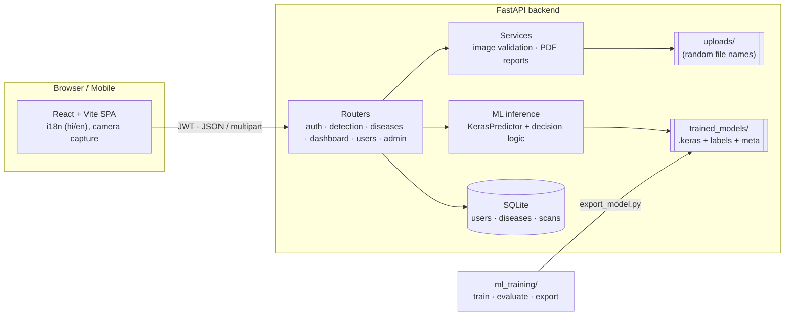
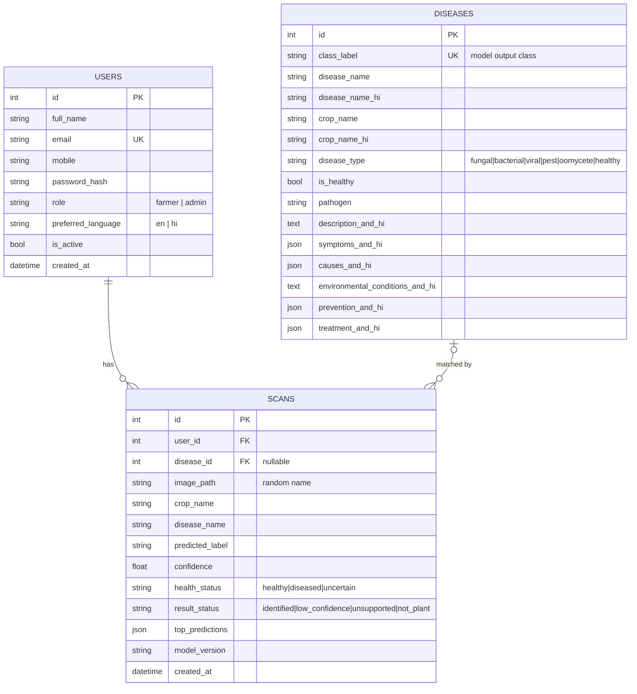
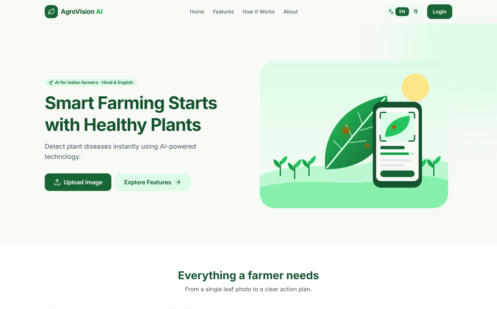
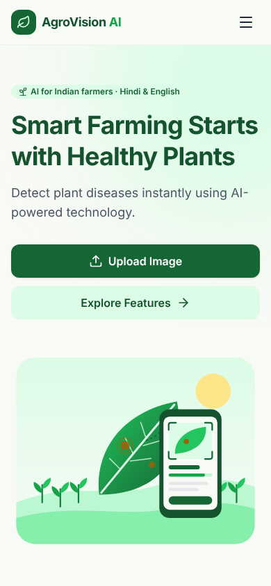
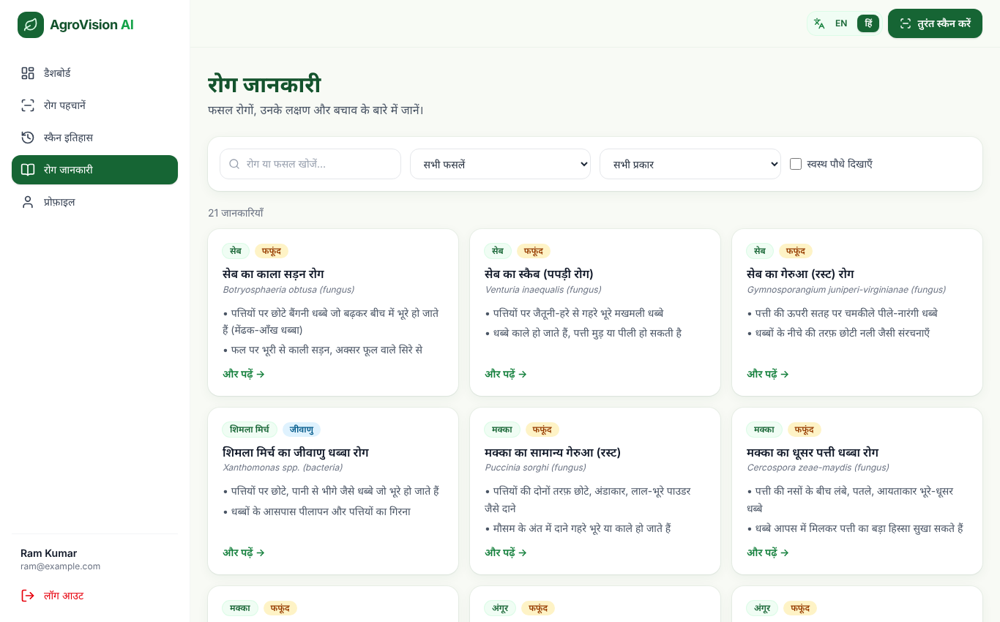

# 🌿 Crop Care AI – Smart Plant Disease Detection & Farmer Assistance System

> B.Tech Final Year Project · AI/ML + Full-Stack Web Application

Crop Care AI lets a farmer photograph or upload a plant leaf and get an AI-based disease diagnosis. The result includes a
confidence score and clear guidance on symptoms, causes, prevention and treatment, in **Hindi and English**. Every scan is
saved, and a PDF report can be downloaded.

> ⚠️ **About the AI model:** this repository contains the full training pipeline. **Trained weights are not included.**
> You train the model once (about 30–60 min on a free Colab GPU, see [Model training](#8-model-training)) and copy it
> into `backend/trained_models/`. Until then the app runs normally, but the detection endpoint returns
> `503 model_unavailable`. It never shows a fake result.

---

## Table of contents
1. [Problem statement](#1-problem-statement)
2. [Objectives](#2-objectives)
3. [Technology stack](#3-technology-stack)
4. [System architecture](#4-system-architecture)
5. [AI/ML workflow](#5-aiml-workflow)
6. [Database schema](#6-database-schema)
7. [API documentation](#7-api-documentation)
8. [Model training](#8-model-training)
9. [Installation & running](#9-installation--running)
10. [Environment configuration](#10-environment-configuration)
11. [Running tests](#11-running-tests)
12. [Project structure](#12-project-structure)
13. [Security](#13-security)
14. [Screenshots](#14-screenshots)
15. [Limitations & future scope](#15-limitations--future-scope)

---

## 1. Problem statement
Crop diseases cause large yield losses in India. Farmers often can't identify a disease early, and expert advice
(the KVK or an agriculture officer) is not always available right away. A late or wrong diagnosis leads to crop loss or
the wrong pesticide being used.

## 2. Objectives
- Detect plant diseases from a leaf photo, captured with a phone camera or uploaded from storage
- Identify the crop and the disease with a **confidence score**, and say clearly when the model is unsure
- Explain symptoms, causes, favourable conditions, prevention and general treatment in **simple Hindi and English**
- Keep a scan history, dashboard statistics and downloadable **PDF reports** (Hindi/English)
- Provide an admin panel for users, the disease knowledge base and analytics
- Run well on mobile, tablet and desktop

## 3. Technology stack
| Layer | Technology |
|---|---|
| Frontend | React 19 + Vite, TypeScript, Tailwind CSS v4, React Router, Axios, Lucide icons, Recharts |
| Backend | Python 3.11+, FastAPI, Pydantic v2, SQLAlchemy 2, Uvicorn, Alembic |
| Image processing | Pillow, OpenCV, NumPy |
| AI/ML | TensorFlow / Keras, MobileNetV2 (or EfficientNetB0) transfer learning, PlantVillage dataset |
| Database | SQLite (dev), any SQLAlchemy-supported DB in production |
| Auth | JWT (python-jose), bcrypt password hashing |
| Reports | ReportLab + Noto Sans Devanagari (+ uharfbuzz for correct Hindi shaping) |
| Tests | pytest + FastAPI TestClient · Vitest + Testing Library |

## 4. System architecture



**Request flow for a prediction:** upload → JWT check → file validation (real format, size, dimensions) → re-encode and
save under a random name → leaf-colour check → resize/normalise → model → confidence-threshold decision → look up
disease info in the DB → save the scan → JSON response.

## 5. AI/ML workflow

| Step | Detail |
|---|---|
| 1. Receive image | `POST /api/detection/predict` (multipart, max 10 MB, JPG/PNG/WEBP) |
| 2. Validate | MIME type, *actual* decoded format (Pillow), decompression-bomb guard, min 64 px |
| 3. Resize | 224 × 224, bilinear |
| 4. Normalise | MobileNetV2 → `[-1, 1]` (`x/127.5 − 1`); EfficientNet → raw 0–255 (rescaling is built in) |
| 5. Infer | Keras model → softmax over **27 classes** |
| 6–7. Pick top | highest-probability class |
| 8. Threshold | `≥ 0.70` → **identified**; otherwise the decision below |
| 9. Return | crop, disease, confidence, top-3, health status, **model version** |
| 10. Disease info | DB lookup by `class_label` (bilingual) |

**Honest uncertainty handling** (`backend/app/ml/predictor.py::decide`):

| Result | When | Shown to farmer |
|---|---|---|
| `identified` | top-1 ≥ 0.70 | disease + full guidance |
| `low_confidence` | top-1 < 0.70 but ≥ 80% of the probability is on one crop | "Unable to identify the disease confidently. Please upload a clearer image." (+ likely crop) |
| `unsupported` | probability spread across crops | "Not one of the supported crops, or the image is unclear" |
| `not_plant` | < 8% leaf-coloured pixels | "No plant leaf detected" |

**Supported crops / classes (PlantVillage):** Apple (4), Corn (4), Grape (4), Bell Pepper (2), Potato (3), Tomato (10).
6 of these classes are "healthy".

**Training:** ImageNet-pretrained backbone. Phase 1 trains a new head on a frozen backbone (Adam 1e-3). Phase 2
fine-tunes the top 40 layers (Adam 1e-5, BatchNorm frozen). Training uses augmentation, class weights, early stopping
and a stratified 80/10/10 split. `evaluate.py` reports accuracy, macro and weighted F1, per-class metrics, a confusion
matrix, and the share of test images that clear the threshold along with their accuracy.

## 6. Database schema



Seed data: `backend/app/database/seed_data/diseases.json` contains all 27 classes in English and Hindi. Treatment
advice is kept general on purpose. It names **no pesticide brands, doses or spray schedules** and always tells the
farmer to consult a local agricultural expert or KVK first.

## 7. API documentation
Interactive Swagger UI: **http://localhost:8000/docs** (ReDoc: `/redoc`).

All responses use one shape:
```json
{ "success": true,  "message": "OK", "data": { } }
{ "success": false, "message": "Invalid email or password", "error": { "code": "invalid_credentials", "status": 401, "details": {} } }
```

| Method | Endpoint | Auth | Description |
|---|---|---|---|
| POST | `/api/auth/register` | – | Register a farmer (admin role is rejected) |
| POST | `/api/auth/login` | – | Get a JWT |
| GET | `/api/auth/me` | user | Current user |
| POST | `/api/detection/predict` | user | Upload a leaf image (`file`) → diagnosis |
| GET | `/api/detection/history` | user | Own scans. Query: `q, disease, health_status, date_from, date_to, page, page_size` |
| GET | `/api/detection/{scan_id}` | owner/admin | Scan details with disease info |
| DELETE | `/api/detection/{scan_id}` | owner | Delete own scan and its image |
| GET | `/api/detection/{scan_id}/image` | owner/admin | Protected image file |
| GET | `/api/detection/{scan_id}/report?lang=en\|hi` | owner/admin | PDF report |
| GET | `/api/detection/model-info` | – | Model status, version and metrics |
| GET | `/api/diseases` | – | List. Filters: `crop, disease_type, healthy` |
| GET | `/api/diseases/search?q=` | – | Search in English or Hindi |
| GET | `/api/diseases/{disease_id}` | – | Disease details |
| GET | `/api/dashboard/stats` | user | Totals, top diseases, 14-day trend |
| GET | `/api/dashboard/recent-scans` | user | Latest scans |
| GET/PUT | `/api/users/profile` | user | View / update profile |
| PUT | `/api/users/change-password` | user | Change password |
| GET | `/api/admin/dashboard` | admin | App analytics + model status |
| GET | `/api/admin/users` | admin | Search users |
| PATCH | `/api/admin/users/{id}` | admin | Activate / deactivate a user |
| POST | `/api/admin/diseases` | admin | Create disease |
| PUT | `/api/admin/diseases/{id}` | admin | Update disease |
| DELETE | `/api/admin/diseases/{id}` | admin | Delete disease |

## 8. Model training
Full guide: [`ml_training/README.md`](ml_training/README.md). The short version:

```bash
cd ml_training
pip install -r requirements.txt
# download PlantVillage from Kaggle into ml_training/dataset/ (see ml_training/README.md)
python train.py --data-dir "dataset/plantvillage dataset/color" --arch mobilenetv2
python evaluate.py          # test-set metrics + confusion matrix
python export_model.py --version 1.0.0   # copies model + labels + meta into backend/trained_models/
```
No GPU? Open `ml_training/notebooks/train_on_colab.ipynb` in Google Colab and run the cells in order.

Report the metrics that `evaluate.py` actually prints, not numbers from papers.

## 9. Installation & running

**Prerequisites:** Python **3.11 or 3.12** (TensorFlow does not support the newest Python versions right away),
Node.js **20+**, Git.

### Backend
```bash
cd backend
python -m venv .venv
# Windows: .venv\Scripts\activate     macOS/Linux: source .venv/bin/activate
pip install -r requirements.txt
pip install -r requirements-ml.txt          # TensorFlow – needed to run the trained model
cp .env.example .env                        # Windows: copy .env.example .env  → then set SECRET_KEY
python -m app.database.init_db              # create tables + seed 27 diseases
python create_admin.py --email admin@agrovision.in --name "Admin" --mobile 9999999999   # prompts for password
uvicorn app.main:app --reload --port 8000
```
→ API at http://localhost:8000 · Swagger docs at http://localhost:8000/docs

Schema changes: `alembic revision --autogenerate -m "..."` then `alembic upgrade head`.
(On first run the app also creates any missing tables automatically.)

### Frontend
```bash
cd frontend
npm install
npm run dev
```
→ Open http://localhost:5173. In development, Vite forwards `/api` to `http://localhost:8000`.

**Testing on a phone (same Wi-Fi):** run `npm run dev -- --host` and open `http://<your-PC-IP>:5173` on the phone.
Mobile browsers only allow the camera over HTTPS or localhost. Over plain LAN HTTP, "Use Camera" falls back to the
phone's file picker, where you can still take a photo.

### Production build
```bash
cd frontend && npm run build        # static files in frontend/dist/
cd backend && uvicorn app.main:app --host 0.0.0.0 --port 8000 --workers 2
```
Serve `frontend/dist` with any static host (Nginx, Netlify, …). Set `VITE_API_URL` at build time and add the frontend
origin to `CORS_ORIGINS`.

## 10. Environment configuration
`backend/.env` (see `.env.example`):

| Variable | Default | Purpose |
|---|---|---|
| `SECRET_KEY` | – | JWT signing key. **Must** be long and random in production |
| `ACCESS_TOKEN_EXPIRE_MINUTES` | 1440 | Token lifetime |
| `DATABASE_URL` | `sqlite:///./agrovision.db` | SQLAlchemy URL |
| `CORS_ORIGINS` | `http://localhost:5173,...` | Allowed frontend origins |
| `UPLOAD_DIR` / `MAX_UPLOAD_MB` | `uploads` / 10 | Image storage and limit |
| `MODEL_DIR` / `MODEL_FILE` | `trained_models` / `agrovision_mobilenetv2.keras` | Model location |
| `CONFIDENCE_THRESHOLD` | 0.70 | Minimum top-1 probability for "identified" |
| `CROP_CONSISTENCY_THRESHOLD` | 0.80 | Separates low-confidence from unsupported |
| `MIN_PLANT_PIXEL_RATIO` | 0.08 | Leaf-colour gate |

`frontend/.env` (optional): `VITE_API_URL` – leave empty in development.

## 11. Running tests
```bash
cd backend && pytest            # 41 tests: auth, JWT, uploads, invalid images, prediction logic, history,
                                # ownership, reports (en/hi), diseases, admin authorisation, DB seed
cd frontend && npm test         # 30 tests: components, form validation, i18n parity, API integration
```
The backend API tests use a **test-only stub predictor**, injected through FastAPI dependency overrides. This lets
them check the threshold, low-confidence and unsupported logic without real weights. A separate test confirms that
the real app answers `503` when no model is installed.

## 12. Project structure
```
agrovision-ai/
├── backend/
│   ├── app/
│   │   ├── api/routes/      auth, detection, diseases, dashboard, users, admin
│   │   ├── api/deps.py      current user, admin guard
│   │   ├── core/            config (.env), security (JWT/bcrypt), logging (secret redaction)
│   │   ├── database/        engine/session, init_db.py, seed_data/diseases.json
│   │   ├── ml/              predictor.py (inference + decision), labels.py
│   │   ├── models/          SQLAlchemy models
│   │   ├── schemas/         Pydantic schemas
│   │   ├── services/        image_service.py, report_service.py
│   │   ├── utils/           error handlers, response helpers
│   │   ├── assets/fonts/    Noto Sans Devanagari (OFL) for Hindi PDFs
│   │   └── main.py
│   ├── migrations/          Alembic
│   ├── tests/               pytest suite
│   ├── uploads/  trained_models/
│   ├── create_admin.py
│   ├── requirements.txt  requirements-ml.txt  .env.example
├── frontend/
│   └── src/  components/ pages/ layouts/ services/ hooks/ context/ i18n/ utils/ test/  App.tsx main.tsx
├── ml_training/  train.py evaluate.py export_model.py common.py notebooks/ dataset/
├── docs/screenshots/
└── README.md
```

## 13. Security
- Passwords hashed with **bcrypt** (12 rounds). Passwords and hashes are never returned or logged
- **JWT** bearer auth. Inactive or deleted users are rejected on every request
- **Role-based access**: `/api/admin/*` requires `role=admin`. Public registration can never create an admin (`create_admin.py` is the only path)
- **Ownership checks**: users can only read, delete or download their own scans, images and reports (others get 404)
- **Upload hardening**: MIME and real-format checks, size cap, decompression-bomb limit, re-encoding (strips metadata and payloads), random file names, path-traversal guard, images served only through an authorised endpoint
- **SQL injection** prevented by the SQLAlchemy ORM with bound parameters
- Logs redact `Authorization` headers, tokens and passwords. Access logs record only method, path and status
- CORS allow-list, `X-Content-Type-Options: nosniff`, secrets kept in `.env`, and the app refuses to start in production with the default `SECRET_KEY`

## 14. Screenshots
| Landing | Mobile | Disease library (Hindi) |
|---|---|---|
|  |  |  |

Add your own screenshots of the detection result, dashboard and PDF report **after training the model**, so they show
real predictions.

## 15. Limitations & future scope
**Current limitations (good to discuss in the viva)**
- PlantVillage images are lab photos on plain backgrounds. Accuracy on real field photos will be lower than test accuracy
- A closed-set classifier always picks one of its 27 classes. The "unsupported" and "not plant" checks are heuristics
- Severity is not estimated (the dataset has no severity labels), and the UI says so
- Password reset by email/OTP is not implemented. The Forgot Password page tells the user to contact the admin

**Future scope**
- Fine-tune on field images (e.g. PlantDoc), and add an "unknown/other" class
- Disease severity via lesion segmentation (U-Net)
- Offline inference on the phone with TensorFlow Lite / a PWA
- SMS/WhatsApp alerts, OTP login, weather-based disease risk alerts
- More crops (rice, wheat, cotton, sugarcane) and more Indian languages
- Integration with KVK experts for human verification of predictions

---
*Guidance only: always consult your local agricultural expert or Krishi Vigyan Kendra before applying any pesticide or
chemical. Kisan Call Centre: 1800-180-1551.*
